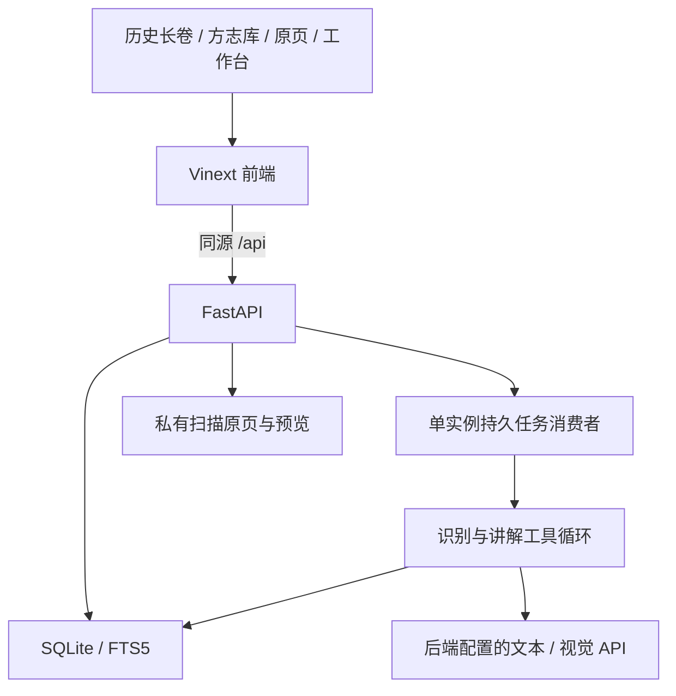

# 当前项目架构

榆林有志采用 React、TypeScript、Vinext 前端，FastAPI 后端，SQLite 与 FTS5 存储及检索。开发与部署分别参见 [README](../README.md) 和 [部署说明](deployment.md)；材料与质量依据分别见 [材料记录](materials.md)、[评测记录](evaluation.md)。

## 页面与数据流

首页使用整理版编年与数据库接口，六章展示 24 个主线节点和折叠编年。文献库与阅读器读取真实材料、原页、文本版本和状态。工作台负责导入、识别批次、草稿编辑、发布、去重与运行记录。

## 后端职责

| 文件 | 职责 |
| --- | --- |
| `backend/app/main.py` | API、会话与管理员鉴权、SSE、请求安全规则 |
| `backend/app/repository.py` | 材料和版本、公开读取门禁、全文检索、编年 |
| `backend/app/db.py` | 有序迁移、事务、数据库一致性 |
| `backend/app/agents.py` | 有界工具循环、识别和白话初译、基于证据的讲解与引文校验 |
| `backend/app/provider.py` | 模型服务适配、用量与限额、错误脱敏 |
| `backend/app/worker.py` | 持久任务状态、批次调度、限流退避与取消 |
| `backend/app/documents.py` | PDF 文字层、原页渲染与图像读取 |
| `backend/app/imports.py` / `dedup.py` | 格式校验、哈希导入、重复页建议和人工合并 |

识别流程为读取原页、选择文字提取或视觉识别、保存原文与初译草稿，之后由整理者校核和发布。机器初稿保留未校勘标识。讲解流程检索已发布文本、符合权限的识别初稿、目录与编年，读取证据后回答；未识别原页可以限量临时转录，不自动发布。引用必须匹配本轮读取的原文，并链接到对应页和版本。

## 文件、安全与运行

`data/raw`、`data/previews`、`data/catalog.sqlite3` 与来源清单需要一起维护；来源权利、可见性与撤回规则覆盖检索、阅读、图片和 Agent 工具。迁移和备份使用 SQLite backup API，保留原有 ID、文本版本和来源。

模型密钥和管理令牌仅由后端读取，真实 `.env*` 不进入前端、Git 或镜像。生产模式校验 HTTPS 来源与管理令牌，启用同源写入校验、安全 Cookie、限流、错误脱敏和禁止缓存；API 文档在生产环境关闭。

`启动.bat` 调用 `scripts/dev.py`，校验环境、选择本机空闲端口、等待前后端就绪再打开首页。本地默认 Node 前端；锁文件防止同一目录重复启动 API 消费者。Ctrl-C 只停止该启动器的子进程树。`.local-dev.lock` 和 `.local-dev.json` 是忽略的本地运行文件，不是部署配置。

保持一个 API 实例与一个消费者；不能直接增加 Uvicorn workers 或多机共享 SQLite。线上由 Caddy 提供 HTTPS 并把 `/api` 转到后端，前端使用 Node standalone。当前已完成本地自动化及浏览器检查，尚未进行公网部署验收。

## 验证入口

在项目根目录运行 Python 测试，以及前端 `typecheck`、`lint`、`build:node`。测试使用隔离数据库与明确的模型替身，不消耗真实模型配额。页面实测与图片来源见 [页面说明](heritage-redesign.md)。
